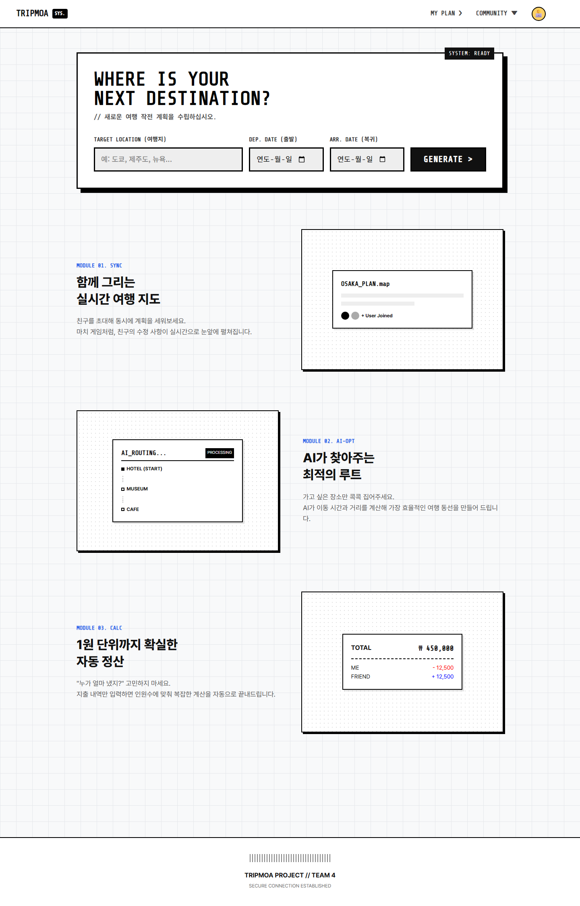
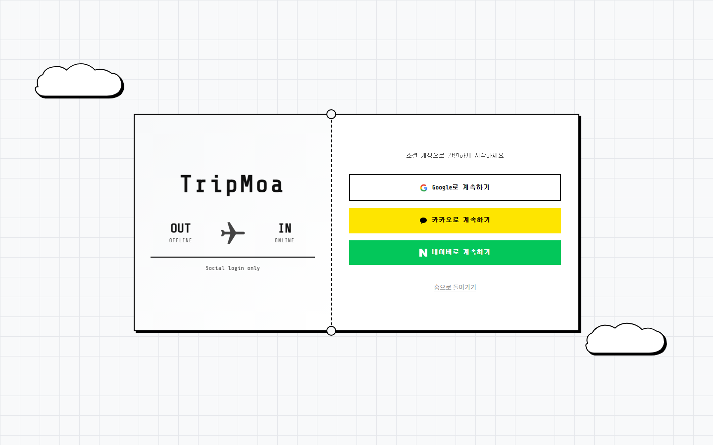
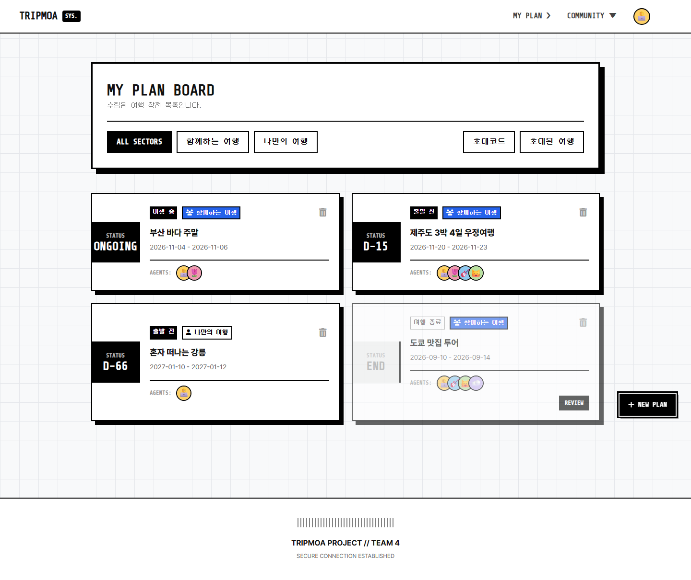
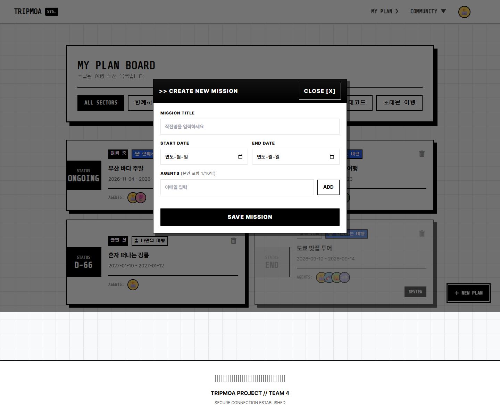
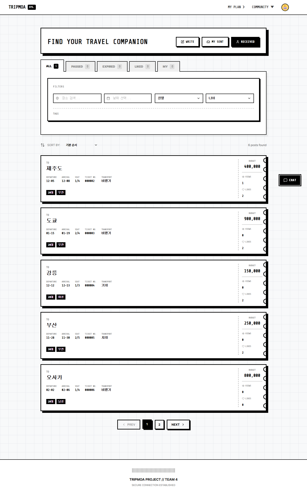
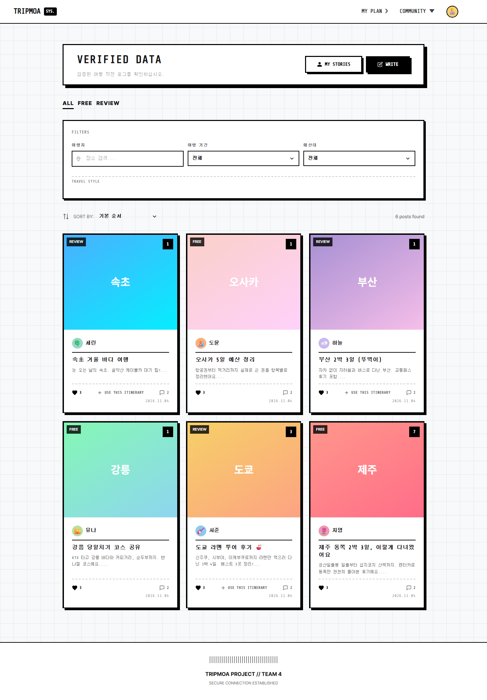
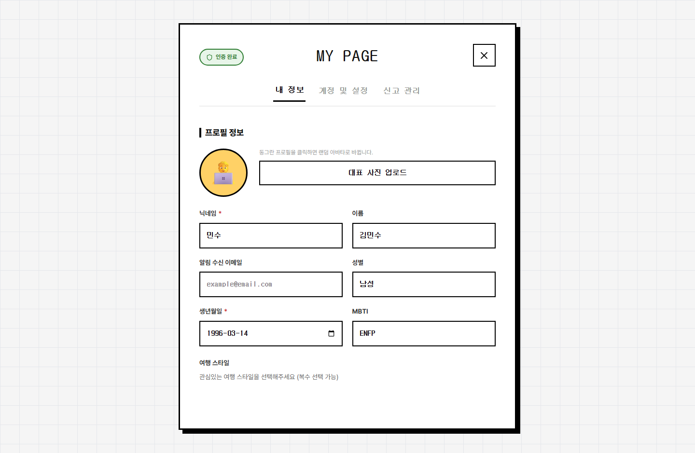
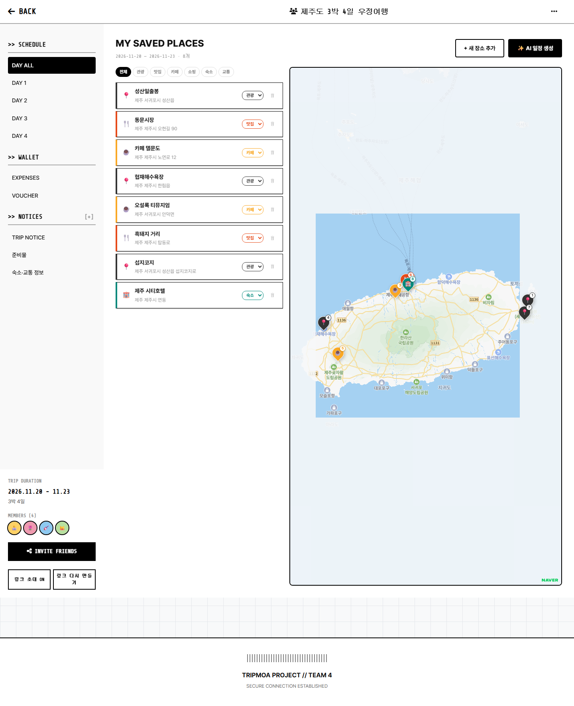

# TripMoa 디자인 개편 · 디자인 시스템

TripMoa의 화면 디자인을 하나의 기준으로 다시 정리하는 작업을 설명한다.
**1~6장**은 서비스 전체의 개편 방향과 화면별 설계, **7~10장**은 화면을 만들 때 쓰는 값·부품·규칙, **11장**은 참고 자료(전체 캡처, 시안 원본)다.

| 항목 | 내용 |
|---|---|
| 기준 버전 | v3 |
| 마지막 갱신 | 2026-11-16 |
| 관리 | nwkim6294 |
| 코드 위치 | `src/shared/styles/` (`tokens.css` · `ui.css` · `tm-layout.css` · `patterns.css`) |
| 이름 규칙 | 클래스는 `tm-`, 변수는 `--tm-`로 시작한다 (기존 클래스와 겹치지 않는다) |

---

## 1. 왜 개편하나

TripMoa는 **친구들과 함께 여행을 짜고, 동행을 찾고, 정산하는 서비스**다. 핵심 흐름은 초대 → 같이 일정 짜기 → 경비 정산 → 여행기 남기기이고, 이 흐름이 화면을 넘나든다.

개편 전에는 화면마다 모양이 달랐다.

- 화면마다 글꼴·테두리·색·버튼이 따로 만들어져서, 같은 서비스인데도 페이지를 넘기면 다른 앱처럼 보였다.
- 두꺼운 테두리, 진한 그림자, 영문 대문자 장식(예: `AGENTS`, `CREATE NEW MISSION`, `STATUS`)이 많아서 **무슨 화면인지 한눈에 읽기 어려웠다.**
- 입력·확인을 브라우저 기본 창(`prompt` · `confirm` · `alert`)으로 받는 곳이 있었고, 모달도 화면마다 따로 만들어져 있었다.
- 11~12px 글씨와 옅은 회색 글씨가 많아서 읽기 불편했다.

## 2. 목표

1. **한 서비스처럼 보이게** — 모든 화면이 같은 값(색·크기·선·간격)과 같은 부품을 쓴다.
2. **읽기 쉽게** — 글씨는 13px 이상, 글자와 바탕의 대비를 충분히 두고, 화면 글은 한글로 쓴다.
3. **덜 어지럽게** — 자주 쓰는 기능은 바로 보이게 두고, 드문 설정은 한 번 눌러야 보이게 접는다.
4. **계속 쓸 수 있게** — 새 화면을 만들 때 다시 고민하지 않도록 값과 부품을 공용 CSS로 모은다.

## 3. 디자인 방향

한 줄로: **"종이 위에 검정 선으로 그린 조용한 도구."**

- **선은 검정 1.5px.** 큰 덩어리(카드·티켓·지도·로그인 상자)는 테두리 전체, 페이지 안의 구역은 위아래 선만 쓴다.
- **강조는 노랑 형광펜.** 선택·켜짐(탭 밑줄, 알약, 선택된 행)은 노랑이다.
- **주 버튼은 빨강, 화면당 하나.** 나머지는 흰 바탕 + 테두리. 지우기·나가기는 `tm-btn--danger`.
- **입력창은 밑줄형**이고, 목록은 흰 바탕의 평평한 줄이다.
- **그림자·둥근 모서리·기울기를 쓰지 않는다.** 그림자는 모달·채팅창처럼 떠 있는 것에만 쓴다. 장식(기울기·테이프)은 **로고, 여행기 폴라로이드, 홈**에만 남긴다. 모서리는 각지게 두고, 알약과 아바타만 둥글다.
- **글씨는 모두 13px 이상**(배지·개수 포함). 페이지 제목은 26px 이하(홈 첫 화면만 34px).
- **화면 글은 한글**로 쓴다. 영문으로 남기는 것은 `DAY 1` 같은 표기와 로고뿐이다.
- **이모지를 쓰지 않는다.** 아이콘이 필요하면 선 아이콘(SVG)을 쓴다. 사용자 프로필의 이모지는 화면에 그리지 않고 닉네임 첫 글자로 보여준다.
- **읽어야 하는 내용은 흰 면 위에 둔다.** 뒤에 32px 격자 배경을 깔고, 격자 위에 글씨를 직접 놓지 않는다.
- 간격은 8px 단위로 맞춘다.

## 4. 화면별 설계

모든 화면을 같은 틀로 적는다: **현재 기능**(바꾸지 않는 것) → **개편 디자인** → **적용 상태**.
기능과 동작은 그대로 두고 모양과 구성만 바꾼다.

"개편 전" 이미지는 `before/`의 캡처(2026-11-05, 로컬 테스트 데이터)이고, 화면마다 대표 한 장(작업 화면은 탭별 링크)만 실었다. "개편 후" 이미지는 앱에 적용되는 대로 추가한다. 전체 캡처는 [11장 참고 자료](#11-참고-자료)에 있다.

### 4.1 공통 머리글 · 푸터 · 메뉴
- **현재 기능**: 모든 화면 위에 로고와 메뉴가 있다.
- **개편 디자인**: 머리글 오른쪽 끝에 항상 `MENU ＋` 버튼을 두고, 누르면 노란 전체 화면 메뉴가 열려 MY TRIP · COMMUNITY · ME 묶음으로 링크를 보여준다. 머리글 아랫줄만 3px로 굵게 둔다.
- **적용 상태**: 적용 예정. 모든 화면에 보이는 부분이라 효과가 가장 크다.

### 4.2 홈 `/`
- **현재 기능**: 여행지와 출발·복귀일을 입력하고 여행을 시작하는 흐름.
- **개편 전**

  

- **개편 디자인**: 서비스를 소개하는 첫 화면. 큰 제목("숙소는 누가 잡았어?")과 입력 폼, 보딩패스형 미리보기 카드, 기능 3가지(같이 찍어요 · 같이 가요 · 1원까지 나눠요), 시작 버튼으로 구성한다. **홈만 예외로** 두꺼운 선·그림자·기울기·손글씨·큰 제목을 그대로 쓴다(`tm-home-*`). 첫인상을 서비스 성격(친구들과 떠나는 가벼운 느낌)에 맞추기 위해서다.
- **적용 상태**: 적용 예정. 손글씨 글꼴(Gaegu)을 따로 불러와야 한다.

### 4.3 로그인 `/login`
- **현재 기능**: Google · 카카오 · 네이버 소셜 로그인, 최근 로그인 표시, 이용 제한 안내, 홈으로 돌아가기.
- **개편 전**

  

- **개편 디자인**: 티켓·구름 장식을 걷어내고 한 장의 카드로 정리했다. 로고 → "같이 떠나볼까요?"(같이에 노랑 형광펜) → 안내 문구 → 소셜 버튼 3개(서비스 마크 포함) → 홈으로 돌아가기(빨간 물결 밑줄) 순서다.
- **적용 상태**: **적용됨.**

### 4.4 내 여행 `/mytrips`
- **현재 기능**: 내 여행 목록, 함께하는/나만의/초대된 여행 필터, 새 여행 만들기, 초대코드로 참여, 삭제(소유주만), 후기 작성 이동.
- **개편 전**

   

- **개편 디자인**: 여행을 색 머리(노랑 · 하늘 · 민트 순서) + 아래 칸의 카드로 보여준다. 머리에 상태·기간·제목, 아래 칸에 날짜·멤버·버튼. 영문 장식 라벨을 한글로 바꾸고, 여행 만들기·초대코드·삭제 확인을 같은 모달 구조로 통일했다.
- **적용 상태**: **적용됨.**

### 4.5 동행 찾기 `/mate`
- **현재 기능**: 동행 글 목록(탭: `ALL` · `PASSED` · `EXPIRED` · `LIKED` · `MY`), 필터(장소 · 날짜 · 성별 · 나이 · 태그 · 정렬), 글쓰기, 보낸/받은 신청, 성인 인증 안내, 상세·신청.
- **개편 전**

  

- **개편 디자인**: 목록 위에 제목과 `보낸 신청 · 받은 신청 · 글쓰기` 버튼, 그 아래 탭과 필터 줄을 둔다. 글 카드는 탑승권 모양(목적지 · 출발 · 도착 · 교통 · 태그 · 작성자 여행 스타일 · 조회/좋아요 · `PASS` 버튼)으로 한눈에 비교하게 하고, 페이지 번호로 넘긴다. 선택된 탭·태그는 노랑 형광펜이다.
- **적용 상태**: 적용 예정. 글 상세·작성·신청 모달은 시안에 아직 없다.

### 4.6 여행기 `/travelstory`
- **현재 기능**: 여행기 목록과 필터(여행지 · 기간 · 예산대 · 여행 스타일), 글쓰기, 내 스토리, 일정 저장, 댓글.
- **개편 전**

  

- **개편 디자인**: 여행기는 사진 중심이라 **폴라로이드 카드**를 유지한다. 필터 패널(여행 스타일 태그 · 초기화)과 카드(커버 · 유형 배지 · 본문 요약 · 태그 · 좋아요 · "이 일정 사용하기" · 댓글 수)를 공통 부품으로 정리한다.
- **적용 상태**: 적용 예정. 작성·상세·댓글 화면은 시안에 아직 없다.

### 4.7 채팅
- **현재 기능**: 동행 신청 등 사용자 간 대화.
- **개편 디자인**: 화면 왼쪽 아래의 빨간 버튼을 누르면 작은 창이 열린다. 대화방 목록과 대화 기록은 말풍선 대신 **선으로 나뉜 기록** 형태로 보여준다.
- **적용 상태**: 적용 예정.

### 4.8 마이페이지 `/setting`
- **현재 기능**: 내 정보 · 계정 설정 · 신고 관리 탭, 프로필 수정(이름, 알림 이메일, 성별, 생년월일, MBTI, 여행 스타일), 인증·이용 제한 표시.
- **개편 전**

  

- **개편 디자인**: "내 신분증"처럼 프로필을 맨 위에 두고, 인증 완료·제한 배지와 3개 탭 아래에 입력 폼(밑줄형 입력, 성향 칩)과 취소·저장 버튼을 둔다.
- **적용 상태**: 적용 예정. 계정 설정·신고 관리 탭 내부는 시안에 아직 없다. 아바타를 지금처럼 이모지로 둘지, 글자·색으로 바꿀지 결정이 필요하다(이모지를 쓰지 않는 기준과 맞추려면 후자).

### 4.9 여행 작업 화면 `/workspace/:id`
- **현재 기능**: 일정(DAY ALL · DAY 1~n), 경비·정산, 바우처, 공지, 멤버 관리, 여행 수정.
- **개편 전**

  

  그 밖의 탭: [일정 시간표](before/workspace-timetable.png) · [경비](before/workspace-expenses.png) · [바우처](before/workspace-voucher.png) · [공지](before/workspace-notice.png)

- **개편 디자인**: 맨 위에 여행 머리글, 왼쪽에 아이콘 레일(일정 · 경비 · 바우처 · 공지), 오른쪽에 본문을 둔다. 네 탭이 같은 부품(요약 줄, 탭 상자, 카드 격자)을 쓰고, 드문 설정은 "자세한 설정"처럼 한 번 눌러야 보이게 접는다. 브라우저 기본 창을 쓰던 입력·확인은 앱 안 모달로 옮겼고, 초대는 멤버 관리 창 한 곳으로 모았다.
- **적용 상태**: **적용됨.**

### 4.10 설정 · 공지/FAQ · 초대
- **개편 디자인**: 설정은 탭 + 폼 그리드 + 성향 칩, 공지/FAQ는 목록 + 아코디언, 초대(`/invite/:code`)는 마이페이지·로그인과 같은 한 장 카드(`tm-center`)로 맞춘다.
- **적용 상태**: 적용 예정.

## 5. 적용 현황 요약

| 화면 | 상태 |
|---|---|
| 로그인 | 적용됨 |
| 내 여행 | 적용됨 |
| 여행 작업 화면 (일정 · 경비 · 바우처 · 공지) | 적용됨 |
| 공통 머리글 · 푸터 · 메뉴 | 적용 예정 |
| 홈 | 적용 예정 |
| 동행 찾기 | 적용 예정 |
| 여행기 | 적용 예정 |
| 채팅 | 적용 예정 |
| 마이페이지 · 설정 | 적용 예정 |
| 공지/FAQ · 초대 | 적용 예정 |

**적용 순서 제안**: 공통 머리글·푸터 → 홈 → 동행 찾기 · 여행기 · 채팅 → 마이페이지 · 설정 → 공지/FAQ · 초대.
머리글을 먼저 맞추면 모든 화면에서 한 서비스처럼 보이는 효과가 가장 크다.

---

# 디자인 시스템 (값 · 부품 · 규칙)

화면을 만들거나 고칠 때 **먼저 여기 있는 값과 부품을 쓰고**, 없는 것만 화면 CSS에 따로 만든다.

## 7. 값 (`tokens.css`)

색·크기·선은 직접 쓰지 않고 변수로 쓴다. 화면 CSS에 `#111`, `2px solid #000` 같은 값을 쓰지 않는다.

| 종류 | 변수 | 용도 |
|---|---|---|
| 글자·테두리 | `--tm-ink` | 기본 검정 |
| 바탕 | `--tm-paper` · `--tm-soft` | 흰 면 · 연한 회색 면 |
| 강조 | `--tm-yellow` · `--tm-yellow-soft` | 노랑 형광펜 · 선택된 행 |
| 빨강 | `--tm-red-strong` | **글자가 올라가는 빨강**(주 버튼, 빨간 글씨, 아바타, 개수 배지). 흰 글씨 대비 4.59:1 |
| | `--tm-red` | 밑줄·테두리·호버 같은 장식(글자를 올리지 않는 곳) |
| 구분선 | `--tm-line` · `--tm-line-strong` | 목록 행 구분 · 점선·강한 구분 |
| 보조 글씨 | `--tm-mute` | 설명·날짜 등 |
| 상태 | `--tm-ok` · `--tm-danger` · `--tm-warn-*` · `--tm-info` (각각 `-bg`) | 성공·오류·주의·안내 |
| 연한 색 | `--tm-tint-yellow/mint/blue/pink/red` | 태그 바탕. 색은 아주 연하게만 쓴다 |
| 브랜드 | `--tm-kakao` · `--tm-naver` | 소셜 로그인 |
| 선 | `--tm-bd-thin`(1.5px, 기본) · `--tm-bd`(2px) · `--tm-bd-heavy`(3px, 머리글·로고) · `--tm-bd-soft`(행 구분) · `--tm-bd-dash`(추가 칸) | |
| 글씨 크기 | `--tm-fs-xs`(13) · `sm`(13.5) · `md`(15, 본문) · `lg`(17, 카드 제목) · `xl`(22) · `2xl`(26, 페이지 제목) · `hero`(34, 홈만) | |
| 간격 | `--tm-gap-1`~`6` = 4 · 8 · 12 · 16 · 24 · 40px | |
| 크기 | `--tm-h-btn`(40) · `--tm-h-btn-sm`(32) · `--tm-h-input`(42) · `--tm-w-narrow`(640) · `--tm-w-page`(1240) | |

**접근성 기준**: 보조 글씨는 `#666` 이상, placeholder는 `#767676`(대비 4.5:1). 카테고리 색을 글씨로 쓰지 않는다(글씨는 검정, 색은 테두리).

## 8. 부품

### 기본 부품 (`ui.css`)
- **버튼** `tm-btn` + `--sm` `--lg` `--block` / `--primary`(빨강) `--dark` `--accent` `--danger` `--ghost` `--link` / `--kakao` `--naver`
- **표시** `tm-tag`(`--yellow` `--mint` `--blue` `--red` `--dark` `--ok` …) · `tm-pill` · `tm-chip` · `tm-badge` · `tm-count` · `tm-avatar`(`--sm` `--dark` `--red`) · `tm-avatar-group`
- **폼** `tm-field` · `tm-label`(`--req`) · `tm-input` · `tm-textarea` · `tm-select` · `tm-check` · `tm-input-group` · `tm-form-grid` · `tm-field__hint` · `tm-field__error`
- **창** `tm-overlay` > `tm-modal`(`--narrow` `--wide`) > `tm-modal__head` · `__body` · `__foot` · `tm-confirm__headline`
- **목록·상태** `tm-list` · `tm-row-card` · `tm-table` · `tm-empty` · `tm-loading` · `tm-toast` · `tm-progress`
- **탐색** `tm-tabs` · `tm-seg` · `tm-dropdown` · `tm-fab`
- **배경** `tm-grid-bg` — 흰 바탕 + 32px 격자. 페이지 바탕에 한 번만 쓴다.
- **간격 도우미** `tm-mt-1~3` · `tm-mb-2~3` · `tm-mr-auto` · `tm-gap-2`

### 페이지 틀 (`tm-layout.css`)
`tm-page`(`--narrow` `--wide`) · `tm-page-head` · `tm-toolbar` · `tm-grid`(`--2` `--3`) · `tm-split` · `tm-center`(로그인·초대) · 머리글·푸터(`tm-header` `tm-menu-overlay`)

### 화면 전용 패턴 (`patterns.css`)
`tm-ticket` · `tm-trip-card` · `tm-post-card` · `tm-notice-item` · `tm-map` · `tm-subsec` · `tm-progress-steps` · `tm-bar-row` · `tm-popover` · `tm-topbar` · `tm-cal` · `tm-drop` · `tm-add-tile` · `tm-linkbtn` 등

## 9. 새 화면을 만들 때

1. 페이지 틀(`tm-page` + `tm-page-head`)로 시작한다.
2. 위 부품으로 먼저 구성한다. 모달은 `tm-overlay > tm-modal` 하나만 쓰고, 화면마다 새 모달 CSS를 만들지 않는다.
3. 부품에 없는 모양은 **그 화면의 CSS에** 먼저 만든다(이름은 화면 접두사로, 예: `ws-` `mt-`). 값은 토큰으로 쓴다.
4. 같은 모양이 두 화면 이상에서 필요해지면 공용 파일로 옮긴다.
5. 공용 CSS(`src/shared/styles`)를 고칠 때는 팀에 알리고 이 문서의 변경 이력에 적는다.

### 체크리스트
- [ ] 색·크기·선·간격을 변수로 썼다 (직접 쓴 `#`값이 없다)
- [ ] 글씨가 모두 13px 이상이다
- [ ] 그림자·둥근 모서리·기울기를 쓰지 않았다
- [ ] 이모지를 쓰지 않았다 (화면 글이 한글이다)
- [ ] 주 버튼(빨강)이 화면에 하나뿐이다
- [ ] 읽어야 하는 글이 흰 면 위에 있다

## 11. 참고 자료

저장소에 두기엔 무겁거나 앱 코드와 성격이 다른 자료는 공용 드라이브에 둔다.

| 자료 | 위치 | 내용 |
|---|---|---|
| 개편 전 화면 캡처 (전체) | 드라이브 `TripMoa 디자인 개편 / 01_개편 전 캡처 (2026-11-05)` <!-- TODO: 드라이브 링크 --> | 데스크톱 57장 · 모바일 36장, 목록은 폴더 안 `INDEX.md`. 로컬 테스트 데이터 기준 |
| 개편 후 화면 캡처 | 드라이브 `TripMoa 디자인 개편 / 02_개편 후 캡처` <!-- TODO: 드라이브 링크 --> | 화면이 적용되는 대로 추가 |
| 시안 · 디자인 시스템 원본 | 드라이브 `TripMoa 디자인 개편 / 03_시안·디자인 시스템` <!-- TODO: 드라이브 링크 --> | 화면 시안(HTML)과 `design-system-v3` 묶음 |
| 개편 전 대표 캡처 | 이 저장소 `docs/design/before/` | 이 문서에 실린 12장 |

> 캡처에는 지도 서비스(네이버 지도) 화면이 포함되어 있으므로, 공유 범위는 팀원으로 제한한다.
